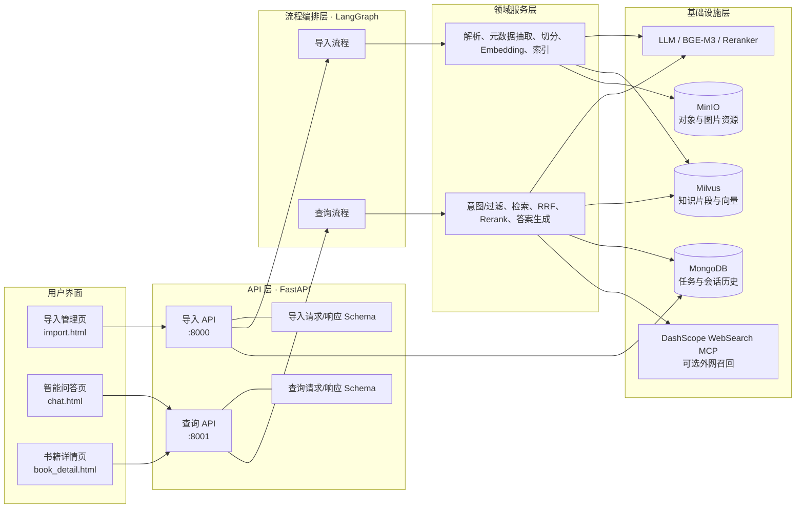
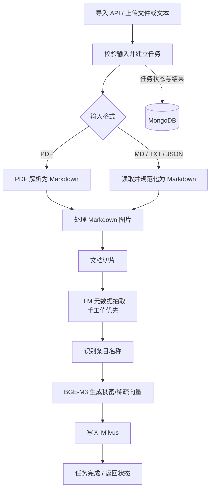
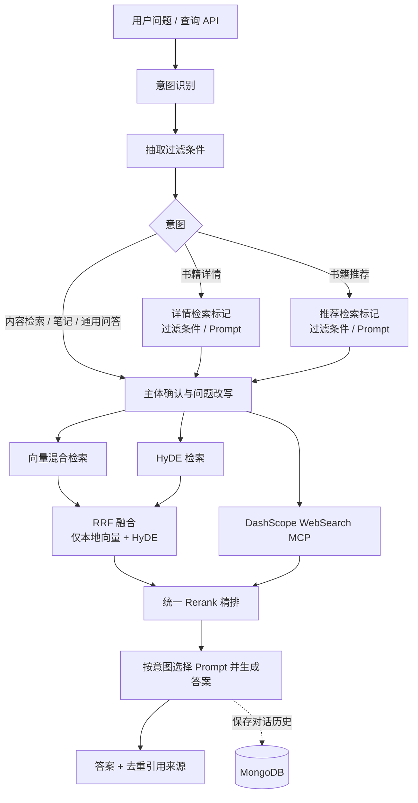

# 听书知识库系统

基于现有分层 RAG 项目扩展的听书资料导入、检索、推荐与问答服务。后端使用 FastAPI、LangGraph、Milvus、MongoDB、MinIO 和 BGE-M3；导入管理、智能问答和书籍详情页面为无需构建的独立 HTML 页面。

## 功能

- 支持有声书信息、书籍简介、作者介绍、听书笔记、推荐运营资料、用户评论摘要、常见问答七类内容。
- 导入 PDF、Markdown、TXT、JSON 文件；导入管理页支持多选或选取文件夹批量提交，并为每个文件独立追踪任务和元数据识别结果。
- 按意图进行书籍推荐、书籍详情、内容检索、笔记查询和通用知识问答；支持引用来源、历史记录与流式响应。聊天页的联网检索开关默认关闭，仅在显式开启时调用 DashScope WebSearch MCP。
- 保留原有 PDF 导入和通用 RAG 查询流程。

## 架构总览

系统按 API、领域服务、流程编排、基础设施和共享组件分层。导入与查询分别由 FastAPI 服务提供入口，LangGraph 负责编排节点；Milvus 保存知识片段及向量，MongoDB 保存任务/会话历史，MinIO 用于对象与图片资源存储。



## 核心流程

### 内容导入

PDF 先解析为 Markdown；Markdown、TXT、JSON 等内容进入统一的 Markdown 处理流程。元数据抽取会识别内容类型、书名、作者、类别、场景标签和时长，用户明确填写的值优先于模型抽取结果。随后内容切片、条目识别、生成稠密/稀疏向量，并将切片及元数据写入 Milvus。



### 查询、推荐与问答

所有意图都经过统一召回、融合、精排和答案生成。意图识别只影响过滤条件和答案模板；书籍详情/推荐节点不独立检索或生成。向量检索与 HyDE 结果进入本地 RRF，联网结果不进入 RRF，而是与 RRF 结果一起交给 Reranker。联网服务不可用时保留本地召回结果继续回答。



### 代码分层关系

| 层 | 职责 | 主要目录 |
| --- | --- | --- |
| API | HTTP 路由、参数校验、SSE 和响应格式 | `app/api/` |
| Process | LangGraph 节点与导入/查询流程编排 | `app/process/` |
| RAG | 元数据抽取、混合检索、融合、重排和回答 | `app/rag/` |
| Infra | LLM、向量库、对象存储、历史记录等适配 | `app/infra/` |
| Shared | 配置、模型加载、日志、Prompt 与通用工具 | `app/shared/` |
| Resources | Prompt 模板与无需构建的 HTML 页面 | `app/resources/` |

## 环境要求

- Python 3.11 或更高版本。
- Milvus、MongoDB、MinIO 服务，以及可用的 OpenAI 兼容 LLM 服务。
- 本地 BGE-M3 与 reranker 模型文件，或按配置使用可访问的模型来源。

复制 `.env_example` 为 `.env`，按当前机器和服务填写配置。`.env` 包含密钥等敏感信息。主要配置项如下：

| 配置 | 用途 |
| --- | --- |
| `OPENAI_BASE_URL`、`OPENAI_API_KEY` | OpenAI 兼容模型服务地址与凭证 |
| `LLM_DEFAULT_MODEL`、`VL_MODEL` | 对话模型与视觉模型名称 |
| `BGE_M3_PATH`、`BGE_DEVICE`、`BGE_FP16` | BGE-M3 模型路径与运行设备 |
| `BGE_RERANKER_LARGE`、`BGE_RERANKER_DEVICE` | Reranker 模型路径与运行设备 |
| `MILVUS_URL`、`CHUNKS_COLLECTION` | Milvus 地址与知识片段 collection |
| `MONGO_URL`、`MONGO_DB_NAME` | MongoDB 地址与数据库 |
| `MINIO_ENDPOINT`、`MINIO_ACCESS_KEY`、`MINIO_SECRET_KEY` | MinIO 连接配置 |
| `MINERU_BASE_URL`、`MINERU_API_TOKEN` | PDF 解析服务配置 |
| `MCP_DASHSCOPE_BASE_URL`、`OPENAI_API_KEY` | 可选的 DashScope WebSearch MCP 地址与访问凭证 |

LLM、embedding 和 reranker 配置由 `app/shared/config/` 中的配置模块读取 `.env`；请使用与当前机器兼容的模型路径和设备。Apple Silicon 可根据本机 PyTorch 支持情况设置 embedding 设备为 `mps`，其他环境可使用 `cpu` 或适用的 CUDA 配置。

### 安装依赖

项目使用 `pyproject.toml` 和 `uv.lock` 管理依赖。安装好 `uv` 后，在项目根目录运行：

```bash
uv sync
```

## 启动服务

先启动并确认 Milvus、MongoDB、MinIO 及模型服务可访问，然后在项目根目录的两个终端分别启动 API：

```bash
uv run uvicorn app.api.http.import_server:app --host 127.0.0.1 --port 8000
```

```bash
uv run uvicorn app.api.http.query_server:app --host 127.0.0.1 --port 8001
```

若使用已经安装好依赖的虚拟环境，可将 `uv run` 替换为对应 Python 环境中的 `python -m uvicorn`。

| 服务 | 页面 | OpenAPI 文档 |
| --- | --- | --- |
| 导入服务（端口 8000） | [导入管理](http://127.0.0.1:8000/html) | [Swagger UI](http://127.0.0.1:8000/docs) |
| 查询服务（端口 8001） | [智能问答](http://127.0.0.1:8001/html)、[书籍详情](http://127.0.0.1:8001/book-detail) | [Swagger UI](http://127.0.0.1:8001/docs) |

前端页面也可直接打开 `app/resources/html/import.html`、`chat.html` 或 `book_detail.html`。直接打开时需确认 API 地址与页面中的默认配置一致，并允许浏览器访问本地 API。

## API 概览

### 导入服务 `:8000`

- `POST /import/audiobook`：导入有声书资料。
- `POST /import/note`：导入听书笔记。
- `POST /import/qa`：导入常见问答。
- 导入页面支持批量操作：共享所选内容类型和可选元数据，每个文件单独创建任务；不同书籍可留空元数据以便分别自动识别。
- `GET /status/{task_id}`：查询导入任务状态。
- `GET /html`：导入管理页面。

导入接口接收 multipart/form-data，可上传 PDF、MD、TXT 或 JSON 文件，也可提交文本内容；具体字段、必填项和响应格式请以 `/docs` 中的 schema 为准。

### 查询服务 `:8001`

- `POST /query/chat`：知识问答，支持流式响应。
- `POST /query/recommend`：书籍推荐。
- `POST /query/book_detail`：书籍详情。
- `POST /query/search`：内容检索。
- `GET /query/history/{session_id}`：查询会话历史。
- `GET /html`、`GET /book-detail`：聊天页与书籍详情页。

查询请求的 JSON 格式及流式响应说明可在 `/docs` 中查看。`web_search_enabled` 默认是 `false`；设置为 `true` 时才会把改写后的问题发送给 DashScope WebSearch MCP，设置为 `false` 时跳过 MCP，仍执行本地向量检索、HyDE、RRF 和 Rerank。注意：该开关只控制外部网页检索，意图识别和 HyDE 仍会使用已配置的 LLM。知识问答与检索结果可包含书名、作者、内容类型和来源文件等引用信息。

## 项目结构

```text
app/
├── api/          # FastAPI 路由与请求/响应 schema
├── infra/        # 模型、对象存储、向量库和持久化基础设施
├── process/      # 导入与查询 LangGraph 流程编排
├── rag/          # 导入、元数据抽取、检索与问答领域服务
├── resources/    # Prompt 模板与零构建 HTML 页面
└── shared/       # 领域配置、模型工具、客户端和公共工具
```

## 运行

在项目根目录可运行：

```bash
python -m app/api.http.import_server.py
python -m app/api.http.query_server.py
```

API 文档页面可用于检查路由与请求 schema；真实导入和查询还需要有效的 `.env`、可用的模型服务以及正确配置的 Milvus collection。
